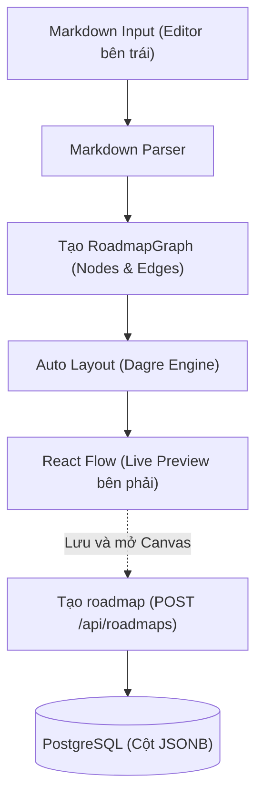

# Betterflow - Contract Phase 1

## 1. Schema Database

- [x] Quy tắc timestamp và xóa dữ liệu.

### 1.1. Bảng `users`

| Tên trường      | Kiểu dữ liệu   | Ràng buộc / Khóa / Chỉ mục   |
| :-------------- | :------------- | :--------------------------- |
| `id`            | `INTEGER`      | **Primary Key**              |
| `email`         | `VARCHAR(255)` | `NOT NULL`, **Unique**       |
| `password_hash` | `VARCHAR(255)` | `NOT NULL`                   |
| `created_at`    | `TIMESTAMPTZ`  | `NOT NULL`, Default: `NOW()` |
| `updated_at`    | `TIMESTAMPTZ`  | `NOT NULL`, Default: `NOW()` |

---

### 1.2. Bảng `roadmaps`

| Tên trường   | Kiểu dữ liệu   | Ràng buộc / Khóa / Chỉ mục         |
| :----------- | :------------- | :--------------------------------- |
| `id`         | `INTEGER`      | **Primary Key**                    |
| `user_id`    | `INTEGER`      | **Foreign Key**, `NOT NULL`        |
| `title`      | `VARCHAR(255)` | `NOT NULL`                         |
| `nodes`      | `JSONB`        | `NOT NULL`, Default: `'[]'::jsonb` |
| `edges`      | `JSONB`        | `NOT NULL`, Default: `'[]'::jsonb` |
| `is_public`  | `BOOLEAN`      | `NOT NULL`, Default: `FALSE`       |
| `share_code` | `VARCHAR(16)`  | **Unique**                         |
| `created_at` | `TIMESTAMPTZ`  | `NOT NULL`, Default: `NOW()`       |
| `updated_at` | `TIMESTAMPTZ`  | `NOT NULL`, Default: `NOW()`       |

### 1.3. Timestamp và xóa dữ liệu

- Database lưu timestamp bằng `TIMESTAMPTZ` và backend trả chuỗi ISO 8601 theo UTC, ví dụ `2026-11-04T07:10:00.000Z`.
- Khi tạo bản ghi, `created_at` và `updated_at` nhận `NOW()` trong cùng câu lệnh `INSERT`.
- Khi sửa user hoặc roadmap, backend giữ nguyên `created_at` và đặt `updated_at = NOW()` ngay trong câu lệnh `UPDATE`, kể cả khi bật hoặc tắt chia sẻ.
- Phase 1 cập nhật timestamp trực tiếp trong câu lệnh SQL, với giá trị mặc định `NOW()` áp dụng khi `INSERT`.
- Backend quản lý các trường `createdAt`, `updatedAt`, `userId`, `id`, `shareCode` và `passwordHash`.
- Xóa roadmap sẽ xóa vĩnh viễn bản ghi cùng node, cạnh và mã chia sẻ.
- Link chia sẻ cũ hoặc yêu cầu xóa lại roadmap đã xóa trả về `404 NOT_FOUND`.
- Khi tác vụ quản trị xóa một user, khóa ngoại `ON DELETE CASCADE` xóa toàn bộ roadmap của user đó.
- Việc xóa tài khoản trong Phase 1 thuộc phạm vi tác vụ quản trị.
- Khi thay đổi schema, thêm migration mới để giữ lịch sử các migration đã áp dụng.

## 2. API contract

### 2.1. Quy ước chung

- **Base URL:** `/api`
- **Content-Type:** `application/json`
- **Authentication:** Các endpoint có đánh dấu 🔒 yêu cầu header:
  ```http
  Authorization: Bearer <jwt_token>
  ```
- **Quy ước đặt tên trường JSON:** Dùng `camelCase` cho mọi request/response body của API (Backend tự map từ `snake_case` của DB sang `camelCase` trước khi trả về).

### 2.2. Cấu trúc response

Response thành công có body JSON bọc kết quả trong trường `data`.

Mọi lỗi trả về từ Backend (400, 401, 403, 404, 409, 500) **bắt buộc** tuân theo cấu trúc sau để Frontend và TanStack Query xử lý thống nhất:

```json
{
  "error": {
    "code": "INVALID_CREDENTIALS",
    "message": "Email hoặc mật khẩu không chính xác"
  }
}
```

**Danh sách mã lỗi (`error.code`) thông dụng:**

- `VALIDATION_ERROR` (400): Thiếu trường bắt buộc hoặc sai định dạng (ví dụ email sai định dạng).
- `INVALID_JSON` (400) áp dụng khi body không phải JSON hợp lệ.
- `INVALID_CREDENTIALS` (401) áp dụng khi email hoặc mật khẩu đăng nhập không đúng.
- `UNAUTHORIZED` (401): Chưa đăng nhập, thiếu token hoặc token đã hết hạn (FE tự động xóa token & chuyển về `/login`).
- `FORBIDDEN` (403): Cố tình truy cập/sửa/xóa roadmap của người khác.
- `NOT_FOUND` (404): Không tìm thấy roadmap hoặc link chia sẻ không tồn tại / đã tắt chia sẻ.
- `EMAIL_ALREADY_EXISTS` (409): Đăng ký trùng email đã có trong hệ thống.
- `INTERNAL_ERROR` (500): Lỗi hệ thống phía server.

---

### 2.3. Nhóm API Xác thực (Auth)

#### 1) Đăng ký tài khoản

- **Endpoint:** `POST /api/auth/register`
- **Auth:** Public
- **Request Body:**
  ```json
  {
    "email": "quang@cmc.com.vn",
    "password": "password123"
  }
  ```
- **Response `201 Created`:**
  ```json
  {
    "data": {
      "token": "eyJhbGciOiJIUzI1NiIsInR5cCI6IkpXVCJ9...",
      "user": {
        "id": 1,
        "email": "quang@cmc.com.vn",
        "createdAt": "2026-11-04T07:00:00.000Z"
      }
    }
  }
  ```

#### 2) Đăng nhập

- **Endpoint:** `POST /api/auth/login`
- **Auth:** Public
- **Request Body:**
  ```json
  {
    "email": "quang@cmc.com.vn",
    "password": "password123"
  }
  ```
- **Response `200 OK`:** Dùng cấu trúc `{ data: { token, user } }` như response đăng ký.

#### 3) Lấy thông tin user hiện tại (kiểm tra phiên đăng nhập)

- **Endpoint:** `GET /api/auth/me`
- **Auth:** 🔒 Cần Token
- **Response `200 OK`:**
  ```json
  {
    "data": {
      "user": {
        "id": 1,
        "email": "quang@cmc.com.vn",
        "createdAt": "2026-11-04T07:00:00.000Z"
      }
    }
  }
  ```

---

### 2.4. Nhóm API Quản lý Roadmap (Dùng cho cả Canvas & Playground)

#### 1) Lấy danh sách roadmap của tôi

- **Endpoint:** `GET /api/roadmaps`
- **Auth:** 🔒 Cần Token
- `nodeCount` là tổng số node trong roadmap.
- `previewNodes` gồm tối đa 3 node đầu theo thứ tự lưu trong `nodes`, mỗi node có `id` và `label` lấy từ `data.label`.
- Roadmap chưa có node trả `previewNodes: []`.
- **Response `200 OK`:** (Trả về danh sách tóm tắt để trang "Roadmap của tôi" tải nhanh)
  ```json
  {
    "data": {
      "roadmaps": [
        {
          "id": 10,
          "title": "Lộ trình học Frontend React",
          "nodeCount": 8,
          "previewNodes": [
            { "id": "setup", "label": "Chuẩn bị môi trường" },
            { "id": "typescript", "label": "Nền tảng TypeScript" },
            { "id": "react", "label": "React cơ bản" }
          ],
          "isPublic": true,
          "shareCode": "k8f2xq",
          "createdAt": "2026-11-04T07:10:00.000Z",
          "updatedAt": "2026-11-04T08:30:00.000Z"
        }
      ]
    }
  }
  ```

#### 2) Tạo mới roadmap (Từ trang danh sách hoặc bấm "Lưu" từ Playground)

- **Endpoint:** `POST /api/roadmaps`
- **Auth:** 🔒 Cần Token
- **Request Body:** (`nodes` và `edges` là tùy chọn; nếu không gửi thì mặc định là `[]`)
  ```json
  {
    "title": "Lộ trình học Frontend React",
    "nodes": [
      {
        "id": "node-1",
        "type": "default",
        "position": { "x": 100, "y": 50 },
        "data": {
          "label": "Nền tảng Web",
          "description": "HTML, CSS, JavaScript ES6+"
        }
      }
    ],
    "edges": []
  }
  ```
- **Response `201 Created`:**
  ```json
  {
    "data": {
      "roadmap": {
        "id": 10,
        "userId": 1,
        "title": "Lộ trình học Frontend React",
        "nodes": [
          {
            "id": "node-1",
            "type": "default",
            "position": {
              "x": 100,
              "y": 50
            },
            "data": {
              "label": "Nền tảng Web",
              "description": "HTML, CSS, JavaScript ES6+"
            }
          }
        ],
        "edges": [],
        "isPublic": false,
        "shareCode": null,
        "createdAt": "2026-11-04T07:10:00.000Z",
        "updatedAt": "2026-11-04T07:10:00.000Z"
      }
    }
  }
  ```

#### 3) Xem chi tiết 1 roadmap (Mở trên Canvas để sửa)

- **Endpoint:** `GET /api/roadmaps/:id`
- **Auth:** 🔒 Cần Token (Chỉ chủ sở hữu mới xem được qua endpoint này)
- **Response `200 OK`:** Trả về `{ "data": { "roadmap": { ... } } }` đầy đủ `nodes` và `edges` giống mục 2.

#### 4) Cập nhật roadmap (Đổi tên hoặc Lưu vị trí/nội dung nodes & edges trên Canvas)

- **Endpoint:** `PUT /api/roadmaps/:id`
- **Auth:** 🔒 Cần Token
- **Request Body:** (Cho phép gửi từng phần hoặc cả 3 trường `title`, `nodes`, `edges`)
  ```json
  {
    "title": "Lộ trình Frontend 2026"
  }
  ```
- **Response `200 OK`:** Trả về `{ "data": { "roadmap": { ... } } }` sau khi đã cập nhật và làm mới `updatedAt`.

#### 5) Xóa roadmap

- **Endpoint:** `DELETE /api/roadmaps/:id`
- **Auth:** 🔒 Cần Token
- **Response `200 OK`:**
  ```json
  {
    "data": {
      "message": "Đã xóa roadmap thành công"
    }
  }
  ```

---

### 2.5. Nhóm API Chia sẻ Roadmap (Share Link)

#### 1) Bật / Tắt chế độ chia sẻ

- **Endpoint:** `PATCH /api/roadmaps/:id/share`
- **Auth:** 🔒 Cần Token
- **Logic Backend:**
  - Nếu `isPublic: true` và roadmap chưa có `share_code`, sinh mã ngẫu nhiên 6 ký tự chữ thường + số (VD: `k8f2xq`) và lưu vào DB. Nếu đã có `share_code` từ trước thì giữ nguyên mã đó để không làm hỏng link cũ.
  - Nếu `isPublic: false`, cập nhật `is_public = false` (mọi truy cập vào link chia sẻ sẽ nhận lỗi `404 NOT_FOUND`).
- **Request Body:**
  ```json
  {
    "isPublic": true
  }
  ```
- **Response `200 OK`:**
  ```json
  {
    "data": {
      "id": 10,
      "isPublic": true,
      "shareCode": "k8f2xq"
    }
  }
  ```

#### 2) Xem roadmap qua link chia sẻ (Chế độ chỉ đọc)

- **Endpoint:** `GET /api/share/:shareCode`
- **Auth:** Public (Không cần đăng nhập)
- **Response `200 OK`:** (Chỉ trả về khi tìm thấy `share_code` VÀ `is_public = true`)
  ```json
  {
    "data": {
      "roadmap": {
        "title": "Lộ trình học Frontend React",
        "nodes": [],
        "edges": [],
        "authorEmail": "quang@cmc.com.vn",
        "updatedAt": "2026-11-04T08:30:00.000Z"
      }
    }
  }
  ```
- **Response `404 Not Found`:** Khi `shareCode` không tồn tại hoặc chủ sở hữu đã tắt chia sẻ (`is_public = false`).

---

## 3. Định dạng dữ liệu nodes/edges

```typescript
// Dữ liệu bên trong mỗi Node của React Flow
export interface RoadmapNodeData extends Record<string, unknown> {
  label: string; // Tên node
  description?: string; // Mô tả chi tiết
}

// Cấu trúc 1 Node
export interface RoadmapNode {
  id: string; // ID duy nhất trong phạm vi 1 roadmap (VD: "node-1", "n_abc123")
  type: 'default'; // dùng chung trên toàn app
  position: {
    x: number; // Tọa độ ngang trên Canvas
    y: number; // Tọa độ dọc trên Canvas
  };
  data: RoadmapNodeData;
}

// Cấu trúc 1 Edge
export interface RoadmapEdge {
  id: string; // Quy ước đặt: "edge-{source}-{target}" (VD: "edge-node-1-node-2")
  source: string; // ID của node bắt đầu
  target: string; // ID của node kết thúc
  type?: 'smoothstep' | 'default';
  animated?: boolean; // Mặc định false
}
```

## Markdown Playground

- [x] Heading, bullet, indent và mô tả.
- [x] Quy tắc sinh node/edge và ID.
- [x] Auto layout và xử lý cú pháp lỗi.
- [x] Khả năng export/import lại graph, đặc biệt với cạnh nối chéo.

Quyết định: dùng heading để khai báo title và node, dòng kế tiếp cho mô tả và khai báo cạnh bằng ID tường minh.
Bản cú pháp này không quy định bullet hoặc indent để tạo quan hệ giữa các node.
Parser viết bằng TypeScript, auto layout dùng Dagre, hiển thị bằng `@xyflow/react` và debounce 200ms.
Cạnh nối chéo được biểu diễn bằng `source` và `target`; xuất Markdown không giữ tọa độ và import sẽ tính lại bố cục.
Auto layout và lỗi cú pháp được xử lý theo quy tắc chi tiết bên dưới.
Khi tạo mới roadmap từ Playground, API yêu cầu `title` ngoài `nodes` và `edges`.

### Quy tắc cú pháp tổng quát

| Cấu phần            | Cú pháp                                           |  Bắt buộc   | Giá trị hợp lệ / Mặc định                                          | Ý nghĩa & Ánh xạ vào `@xyflow/react`                                                                                                                             |
| :------------------ | :------------------------------------------------ | :---------: | :----------------------------------------------------------------- | :--------------------------------------------------------------------------------------------------------------------------------------------------------------- |
| **Tiêu đề Roadmap** | `# <title>`                                       |    Không    | Text tự do                                                         | Đặt tên cho roadmap. **Không tạo Node**                                                                                                                          |
| **Khai báo Node**   | `## [<id>] <label>`                               | Khi có node | `<id>`: `[a-zA-Z0-9_-]+`; `<label>`: Text tự do                    | `<id>` → `node.id`; `<label>` → `node.data.label`                                                                                                                |
| **Mô tả Node**      | Dòng văn bản ngay sau `## [id] ...`               |    Không    | Text tự do (một dòng)                                              | → `node.data.description`                                                                                                                                        |
| **Khai báo Edge**   | `<source> → <target>` hoặc `<source> -> <target>` |    Không    | Cả 2 ID phải đã khai báo. `[animated]` và `[type=...]` là tùy chọn | `source` → `edge.source`; `target` → `edge.target`; `[animated]` → `edge.animated = true`; `[type=default]` → `edge.type = "default"` (mặc định: `"smoothstep"`) |

---

### Bảng ánh xạ ví dụ thực tế

| Tình huống sử dụng | Cú pháp Markdown Playground                            | Thuộc tính `@xyflow/react` tương ứng                                       |
| :----------------- | :----------------------------------------------------- | :------------------------------------------------------------------------- |
| Tiêu đề roadmap    | `# Onboarding Frontend`                                | Roadmap title = `"Onboarding Frontend"`                                    |
| Node đơn giản      | `## [setup] Chuẩn bị môi trường`                       | `id: "setup"`, `data: { label: "Chuẩn bị môi trường" }`                    |
| Node có mô tả      | `## [ts] TypeScript` → dòng tiếp `Kiểu dữ liệu và hàm` | `data: { label: "TypeScript", description: "Kiểu dữ liệu và hàm" }`        |
| Nối cơ bản         | `setup → ts`                                           | `source: "setup"`, `target: "ts"`, `type: "smoothstep"`, `animated: false` |
| Nối có hiệu ứng    | `ts → react [animated]`                                | `animated: true`, `type: "smoothstep"`                                     |
| Nối cong bezier    | `a → b [type=default]`                                 | `type: "default"`, `animated: false`                                       |

---

### Ví dụ file Markdown mẫu

```markdown
# Onboarding Frontend

## [setup] Chuẩn bị môi trường

Cài Git và Node.js

## [ts] Nền tảng TypeScript

Kiểu dữ liệu và hàm

## [react] React cơ bản

Component, props và state

setup → ts
ts → react
```

---

### Quy trình xử lý



**Giải thích:**

1. Người dùng nhập Markdown theo cú pháp `# Title`, `## [id] Label`, dòng mô tả, và `id1 → id2`.
2. Parser phân tích từng dòng: nhận diện node qua `## [id]`, mô tả qua dòng liền kế, edge qua `→` hoặc `->`.
3. Tạo mảng `RoadmapNode[]` và `RoadmapEdge[]` đúng chuẩn `@xyflow/react`.
4. Dagre tính toán tọa độ node theo quy tắc auto layout bên dưới; không thay đổi ID, nội dung hoặc hướng cạnh.
5. React Flow nhận dữ liệu và cập nhật sơ đồ trực quan theo thời gian thực (debounce 200ms).
6. Nút **Lưu thành roadmap** mở hộp thoại cho phép sửa tên và hiển thị số node, số đường nối.
7. Khi người dùng chọn **Lưu và mở Canvas**, frontend gửi `{ title, nodes, edges }` lên API tạo mới và mở roadmap vừa lưu.

---

### Auto layout và xử lý cú pháp lỗi

Graph chấp nhận tối đa 500 node và 1.000 cạnh.

- Sau 200ms kể từ lần gõ cuối, parser chạy trên toàn bộ tài liệu và chỉ cập nhật preview nếu kết quả hợp lệ.
- Parser xử lý hai lượt: thu thập node trước, kiểm tra và tạo edge sau; một edge có thể tham chiếu node khai báo ở dòng phía dưới.
- Chỉ chấp nhận tối đa một heading `# <title>`; nếu không có title thì dùng `Roadmap chưa đặt tên`, title có nhưng rỗng là lỗi.
- Dòng trống được bỏ qua; tài liệu trống tạo graph rỗng hợp lệ, không có node hoặc edge nào.
- Description chỉ là một dòng ngay sau khai báo node; một dòng khác không thuộc cú pháp đã định nghĩa là lỗi, không tự chuyển bullet/indent thành node.
- Nếu description có hình thức giống khai báo title, node, edge hoặc bắt đầu bằng dấu `\`, exporter thêm một dấu `\` ở đầu; parser bỏ đúng một dấu escape này khi đọc description ngay sau node.
- ID trùng, label rỗng, ID không hợp lệ, edge thiếu node, self-loop, cặp cạnh trùng, tùy chọn không hỗ trợ và dữ liệu vượt giới hạn graph đều là lỗi.
- Edge chấp nhận `[animated]`, `[type=default]` hoặc `[type=smoothstep]`, mỗi tùy chọn tối đa một lần, theo thứ tự bất kỳ ở cuối dòng.
- Báo lỗi bằng danh sách `{ line, column, code, message }`, trong đó line/column bắt đầu từ 1 và message dùng để hiển thị cạnh editor; lỗi parser là lỗi local, không gọi API.
- Các code parser gồm `INVALID_SYNTAX`, `DUPLICATE_NODE_ID`, `UNKNOWN_NODE`, `INVALID_EDGE`, `GRAPH_LIMIT_EXCEEDED` và `LAYOUT_FAILED`.
- Khi bản nháp có lỗi, giữ preview hợp lệ gần nhất và hiển thị rõ preview chưa khớp bản nháp; nếu chưa có kết quả hợp lệ thì preview rỗng.
- Khóa nút lưu và xuất file từ Playground khi bản nháp có lỗi, đang chờ debounce hoặc đang tính layout; không tự lưu hoặc gửi graph hợp lệ cũ thay cho bản nháp lỗi.
- Bỏ kết quả parse/layout cũ nếu người dùng đã sửa nội dung sau khi tác vụ bắt đầu, để preview luôn tương ứng phiên bản mới nhất.
- Dagre dùng hướng từ trên xuống (`rankdir: TB`), khoảng cách cùng tầng `nodesep: 40`, giữa các tầng `ranksep: 80`, lề `marginx/marginy: 24` pixel.
- Dùng kích thước node đã đo; nếu chưa đo thì dùng fallback rộng 240 và cao 100 pixel, đo lại sau render khi kích thước thay đổi.
- Chuyển tọa độ tâm Dagre sang góc trên trái React Flow bằng cách trừ nửa chiều rộng/chiều cao node; chỉ gọi `fitView` sau khi áp dụng layout hợp lệ.
- Chu trình không bị xóa hoặc đảo source/target trong graph; việc Dagre xử lý chu trình nội bộ chỉ phục vụ tính bố cục.
- Nếu layout lỗi, trả lỗi local `LAYOUT_FAILED`, giữ preview hợp lệ gần nhất và không tự thay graph bằng mảng rỗng.
- Chỉ auto layout ở Playground khi parse hợp lệ hoặc khi người dùng chủ động yêu cầu; không ghi đè tọa độ khi tải roadmap từ API.

### Quy tắc xuất Markdown

- Xuất title thành `# title`, sau đó xuất toàn bộ node trước và edge sau để parser đọc lại được.
- Mỗi Node xuất thành `## [id] label` + dòng description ngay bên dưới (nếu có).
- Mỗi Edge xuất thành `source → target` kèm `[animated]` và/hoặc `[type=...]` nếu khác mặc định.
- Giữ nguyên node ID, label, description, source/target, edge type và animated sau vòng xuất/nhập; ID edge có thể được sinh lại theo quy tắc chống trùng.
- Không lưu tọa độ `x`, `y` vào nội dung Markdown - Auto Layout (Dagre) sẽ tính lại khi import.

## Ghi nhận thống nhất

- Nhóm dùng tài liệu "Betterflow - Thống nhất thiết kế kỹ thuật (Kick-off)" làm cơ sở cho contract Phase 1.
- Buổi kick-off diễn ra ngày 09/11/2026 với Quang Huy và Minh Thắng.
- Contract ghi nhận thiết kế schema `users` và `roadmaps`, cách quản lý timestamp và quy tắc xóa dữ liệu.
- Các mục API mô tả xác thực, CRUD và chia sẻ roadmap, với `data` cho response thành công và `error` cho response lỗi.
- Danh sách roadmap quy định `nodeCount` cho tổng số node và `previewNodes` cho phần xem trước trên dashboard.
- Mục Markdown Playground ghi lại cú pháp, giới hạn graph, auto layout, cách báo lỗi và quy tắc xuất Markdown.

Dấu tích trong checklist cho biết quy tắc đã được ghi vào tài liệu.
Nhóm rà soát các quyết định trong pull request trước khi dùng làm cơ sở triển khai.
Các giá trị trong ví dụ dùng để minh họa cấu trúc request và response.
