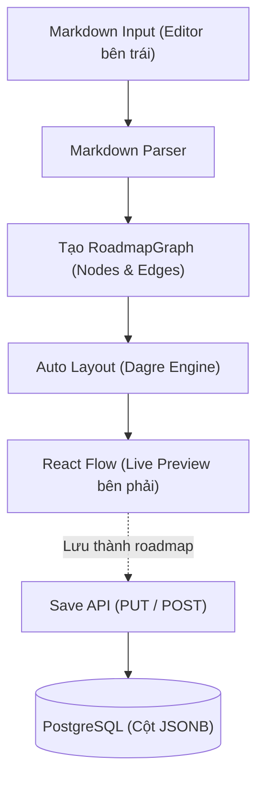

# Các contract cần nhóm thống nhất

Trạng thái: **ĐÃ GHI NHẬN NỘI DUNG KICK-OFF, CÒN CÁC CHI TIẾT CẦN CHỐT**.
Scaffold chưa triển khai schema hoặc API nghiệp vụ.
Nội dung dưới đây ghi nhận thiết kế nhóm cung cấp để triển khai các task tương ứng.
Các checkbox thể hiện mức độ đã có thông tin trong tài liệu, không phải trạng thái hoàn thành code.

## Schema database

- [x] Bảng user và ràng buộc email.
- [x] Bảng roadmap, quyền sở hữu và cách lưu graph.
- [x] Token chia sẻ, cách bật/tắt và thu hồi link.
- [ ] Quy tắc timestamp và xóa dữ liệu.

Quyết định: dùng PostgreSQL 18, hai bảng `users` và `roadmaps`, khóa chính INTEGER và lưu `nodes`/`edges` bằng JSONB.
Tắt chia sẻ bằng `is_public = false`; khi bật lại giữ mã cũ nếu đã có, chưa có cơ chế đổi mã để thu hồi vĩnh viễn link cũ.
Timestamp mặc định là `NOW()`; thao tác cập nhật roadmap phải làm mới `updated_at`.
Cách tự sinh khóa chính, cơ chế cập nhật timestamp và hành vi khóa ngoại khi xóa user chưa được nêu cụ thể.

### Bảng `users`

| Tên trường      | Kiểu dữ liệu   | Ràng buộc / Khóa / Chỉ mục   |
| :-------------- | :------------- | :--------------------------- |
| `id`            | `INTEGER`      | **Primary Key**              |
| `email`         | `VARCHAR(255)` | `NOT NULL`, **Unique**       |
| `password_hash` | `VARCHAR(255)` | `NOT NULL`                   |
| `created_at`    | `TIMESTAMPTZ`  | `NOT NULL`, Default: `NOW()` |
| `updated_at`    | `TIMESTAMPTZ`  | `NOT NULL`, Default: `NOW()` |

---

### Bảng `roadmaps`

| Tên trường   | Kiểu dữ liệu   | Ràng buộc / Khóa / Chỉ mục         |
| :----------- | :------------- | :--------------------------------- |
| `id`         | `INTEGER`      | **Primary Key**                    |
| `user_id`    | `INTEGER`      | **Foreign Key**, `NOT NULL`        |
| `title`      | `VARCHAR(255)` | `NOT NULL`                         |
| `nodes`      | `JSONB`        | `NOT NULL`, Default: `'[]'::jsonb` |
| `edges`      | `JSONB`        | `NOT NULL`, Default: `'[]'::jsonb` |
| `is_public`  | `BOOLEAN`      | `NOT NULL`, Default: `FALSE`       |
| `share_code` | `VARCHAR(16)`  | **Unique**                         |
| `created_at` | `TIMESTAMPTZ`  | `NOT NULL`, Default: `NOW()`       |
| `updated_at` | `TIMESTAMPTZ`  | `NOT NULL`, Default: `NOW()`       |

## API contract

- [x] Endpoint, request và response cho auth.
- [x] Endpoint, request và response cho CRUD roadmap.
- [x] Endpoint private/public cho chia sẻ.
- [ ] Validation, status code và quyền truy cập.

Scaffold đã dùng tiền tố `/api` và success envelope `{ data: ... }`.
Error envelope hiện tại là `{ error: { code, message } }`.
Các health endpoint được mô tả trong README.
Các ví dụ nghiệp vụ bên dưới giữ cấu trúc từ bản kick-off, chưa bọc `data`; nhóm cần xác nhận envelope trước khi triển khai để đồng bộ với scaffold.
Quyền truy cập và các status code chính đã được nêu; validation chi tiết và status của `INVALID_CREDENTIALS` chưa được xác định đầy đủ.

### Quy ước chung

- **Base URL:** `/api`
- **Content-Type:** `application/json`
- **Authentication:** Các endpoint có đánh dấu 🔒 yêu cầu header:
  ```http
  Authorization: Bearer <jwt_token>
  ```
- **Quy ước đặt tên trường JSON:** Dùng `camelCase` cho mọi request/response body của API (Backend tự map từ `snake_case` của DB sang `camelCase` trước khi trả về).

### Api response và format lỗi

Mọi lỗi trả về từ Backend (400, 401, 403, 404, 409, 500) **bắt buộc** tuân theo cấu trúc sau để Frontend và TanStack Query xử lý thống nhất:

```json
{
  "error": {
    "code": "INVALID_CREDENTIALS",
    "message": "Email hoặc mật khẩu không chính xác"
  }
}
```

**Danh sách mã lỗi (`error.code`) thông dụng:**

- `VALIDATION_ERROR` (400): Thiếu trường bắt buộc hoặc sai định dạng (email, JSON...).
- `UNAUTHORIZED` (401): Chưa đăng nhập, thiếu token hoặc token đã hết hạn (FE tự động xóa token & chuyển về `/login`).
- `FORBIDDEN` (403): Cố tình truy cập/sửa/xóa roadmap của người khác.
- `NOT_FOUND` (404): Không tìm thấy roadmap hoặc link chia sẻ không tồn tại / đã tắt chia sẻ.
- `EMAIL_ALREADY_EXISTS` (409): Đăng ký trùng email đã có trong hệ thống.
- `INTERNAL_ERROR` (500): Lỗi hệ thống phía server.

---

### Nhóm API Xác thực (Auth)

#### Đăng ký tài khoản

- **Endpoint:** `POST /api/auth/register`
- **Auth:** Public
- **Request Body:**
  ```json
  {
    "email": "quang@cmc.com.vn",
    "password": "password123"
  }
  ```
- **Response `201 Created`:**
  ```json
  {
    "token": "eyJhbGciOiJIUzI1NiIsInR5cCI6IkpXVCJ9...",
    "user": {
      "id": 1,
      "email": "quang@cmc.com.vn",
      "createdAt": "2026-11-04T07:00:00.000Z"
    }
  }
  ```

#### Đăng nhập

- **Endpoint:** `POST /api/auth/login`
- **Auth:** Public
- **Request Body:**
  ```json
  {
    "email": "quang@cmc.com.vn",
    "password": "password123"
  }
  ```
- **Response `200 OK`:** Giống hệt cấu trúc `201 Created` của Đăng ký.

#### Lấy thông tin user hiện tại (kiểm tra phiên đăng nhập)

- **Endpoint:** `GET /api/auth/me`
- **Auth:** 🔒 Cần Token
- **Response `200 OK`:**
  ```json
  {
    "user": {
      "id": 1,
      "email": "quang@cmc.com.vn",
      "createdAt": "2026-11-04T07:00:00.000Z"
    }
  }
  ```

---

### Nhóm API Quản lý Roadmap (Dùng cho cả Canvas & Playground)

#### Lấy danh sách roadmap của tôi

- **Endpoint:** `GET /api/roadmaps`
- **Auth:** 🔒 Cần Token
- **Response `200 OK`:** (Trả về danh sách tóm tắt để trang "Roadmap của tôi" tải nhanh)
  ```json
  {
    "roadmaps": [
      {
        "id": 10,
        "title": "Lộ trình học Frontend React",
        "nodeCount": 8,
        "isPublic": true,
        "shareCode": "k8f2xq",
        "createdAt": "2026-11-04T07:10:00.000Z",
        "updatedAt": "2026-11-04T08:30:00.000Z"
      }
    ]
  }
  ```

#### Tạo mới roadmap (Từ trang danh sách hoặc bấm "Lưu" từ Playground)

- **Endpoint:** `POST /api/roadmaps`
- **Auth:** 🔒 Cần Token
- **Request Body:** (`nodes` và `edges` là tùy chọn; nếu không gửi thì mặc định là `[]`)
  ```json
  {
    "title": "Lộ trình học Frontend React",
    "nodes": [
      {
        "id": "node-1",
        "type": "roadmapNode",
        "position": { "x": 100, "y": 50 },
        "data": {
          "label": "Nền tảng Web",
          "description": "HTML, CSS, JavaScript ES6+",
          "level": "milestone"
        }
      }
    ],
    "edges": []
  }
  ```
- **Response `201 Created`:**
  ```json
  {
    "roadmap": {
      "id": 10,
      "userId": 1,
      "title": "Lộ trình học Frontend React",
      "nodes": [
        {
          "id": "node-1",
          "type": "roadmapNode",
          "position": { "x": 100, "y": 50 },
          "data": {
            "label": "Nền tảng Web",
            "description": "HTML, CSS, JavaScript ES6+",
            "level": "milestone"
          }
        }
      ],
      "edges": [],
      "isPublic": false,
      "shareCode": null,
      "createdAt": "2026-11-04T07:10:00.000Z",
      "updatedAt": "2026-11-04T07:10:00.000Z"
    }
  }
  ```

#### Xem chi tiết 1 roadmap (Mở trên Canvas để sửa)

- **Endpoint:** `GET /api/roadmaps/:id`
- **Auth:** 🔒 Cần Token (Chỉ chủ sở hữu mới xem được qua endpoint này)
- **Response `200 OK`:** Trả về `{ "roadmap": { ... } }` đầy đủ `nodes` và `edges` giống mục 2.

#### Cập nhật roadmap (Đổi tên hoặc Lưu vị trí/nội dung nodes & edges trên Canvas)

- **Endpoint:** `PUT /api/roadmaps/:id`
- **Auth:** 🔒 Cần Token
- **Request Body:** (Cho phép gửi từng phần hoặc cả 3 trường `title`, `nodes`, `edges`)
  ```text
  {
    "title": "Lộ trình Frontend 2026",
    "nodes": [...],
    "edges": [...]
  }
  ```
- **Response `200 OK`:** Trả về `{ "roadmap": { ... } }` sau khi đã cập nhật và làm mới `updatedAt`.

#### Xóa roadmap

- **Endpoint:** `DELETE /api/roadmaps/:id`
- **Auth:** 🔒 Cần Token
- **Response `200 OK`:**
  ```json
  {
    "message": "Đã xóa roadmap thành công"
  }
  ```

---

### Nhóm API Chia sẻ Roadmap (Share Link)

#### Bật / Tắt chế độ chia sẻ

- **Endpoint:** `PATCH /api/roadmaps/:id/share`
- **Auth:** 🔒 Cần Token
- **Logic Backend:**
  - Nếu `isPublic: true` và roadmap chưa có `share_code`, sinh mã ngẫu nhiên 6 ký tự chữ thường + số (VD: `k8f2xq`) và lưu vào DB. Nếu đã có `share_code` từ trước thì giữ nguyên mã đó để không làm hỏng link cũ.
  - Nếu `isPublic: false`, cập nhật `is_public = false` (mọi truy cập vào link chia sẻ sẽ nhận lỗi `404 NOT_FOUND`).
- **Request Body:**
  ```json
  {
    "isPublic": true
  }
  ```
- **Response `200 OK`:**
  ```json
  {
    "id": 10,
    "isPublic": true,
    "shareCode": "k8f2xq"
  }
  ```

#### Xem roadmap qua link chia sẻ (Chế độ chỉ đọc)

- **Endpoint:** `GET /api/share/:shareCode`
- **Auth:** Public (Không cần đăng nhập)
- **Response `200 OK`:** (Chỉ trả về khi tìm thấy `share_code` VÀ `is_public = true`)
  ```text
  {
    "roadmap": {
      "title": "Lộ trình học Frontend React",
      "nodes": [...],
      "edges": [...],
      "authorEmail": "quang@cmc.com.vn",
      "updatedAt": "2026-11-04T08:30:00.000Z"
    }
  }
  ```
- **Response `404 Not Found`:** Khi `shareCode` không tồn tại hoặc chủ sở hữu đã tắt chia sẻ (`is_public = false`).

## Định dạng graph dùng chung

- [x] Kiểu node, label, description, position và ID.
- [x] Kiểu edge và quy tắc kết nối.
- [ ] Phiên bản dữ liệu và viewport nếu cần.
- [ ] Validation và giới hạn kích thước.

Quyết định: Canvas, Playground và backend dùng chung cấu trúc `nodes`/`edges` dưới đây.
Node dùng `type: "default"`; edge mặc định là `smoothstep` và `animated: false`.
Ví dụ API ở trên vẫn dùng `roadmapNode` và `data.level` theo bản nguồn; nhóm cần đồng bộ các ví dụ này với định dạng graph trước khi triển khai.
Phiên bản graph, viewport, giới hạn kích thước và cách xử lý graph không hợp lệ chưa được nêu.

```typescript
// Dữ liệu bên trong mỗi Node của React Flow
export interface RoadmapNodeData extends Record<string, unknown> {
  label: string; // Tên node
  description?: string; // Mô tả chi tiết
}

// Cấu trúc 1 Node
export interface RoadmapNode {
  id: string; // ID duy nhất trong phạm vi 1 roadmap (VD: "node-1", "n_abc123")
  type: "default"; // dùng chung trên toàn app
  position: {
    x: number; // Tọa độ ngang trên Canvas
    y: number; // Tọa độ dọc trên Canvas
  };
  data: RoadmapNodeData;
}

// Cấu trúc 1 Edge
export interface RoadmapEdge {
  id: string; // Quy ước đặt: "edge-{source}-{target}" (VD: "edge-node-1-node-2")
  source: string; // ID của node bắt đầu
  target: string; // ID của node kết thúc
  type?: "smoothstep" | "default";
  animated?: boolean; // Mặc định false
}
```

## Markdown Playground

- [x] Heading, bullet, indent và mô tả.
- [x] Quy tắc sinh node/edge và ID.
- [ ] Auto layout và xử lý cú pháp lỗi.
- [x] Khả năng export/import lại graph, đặc biệt với cạnh nối chéo.

Quyết định: dùng heading để khai báo title và node, dòng kế tiếp cho mô tả và khai báo cạnh bằng ID tường minh.
Bản cú pháp này không quy định bullet hoặc indent để tạo quan hệ giữa các node.
Parser viết bằng TypeScript, auto layout dùng Dagre, hiển thị bằng `@xyflow/react` và debounce 200ms.
Cạnh nối chéo được biểu diễn bằng `source` và `target`; xuất Markdown không giữ tọa độ và import sẽ tính lại bố cục.
Cách báo lỗi cú pháp khi đang gõ, xử lý ID trùng và các cạnh không hợp lệ chưa được nêu cụ thể.
Khi tạo mới roadmap từ Playground, API yêu cầu `title` ngoài `nodes` và `edges`.

### Quy tắc cú pháp tổng quát

| Cấu phần | Cú pháp | Bắt buộc | Giá trị hợp lệ / Mặc định | Ý nghĩa & Ánh xạ vào `@xyflow/react` |
| :--- | :--- | :---: | :--- | :--- |
| **Tiêu đề Roadmap** | `# <title>` | Không | Text tự do |  Đặt tên cho roadmap. **Không tạo Node** |
| **Khai báo Node** | `## [<id>] <label>` | Có | `<id>`: `[a-zA-Z0-9_-]+`; `<label>`: Text tự do | `<id>` → `node.id`; `<label>` → `node.data.label` |
| **Mô tả Node** | Dòng văn bản ngay sau `## [id] ...` | Không | Text tự do (một dòng) | → `node.data.description` |
| **Khai báo Edge** | `<source> → <target>` hoặc `<source> -> <target>` | Có | Cả 2 ID phải đã khai báo. `[animated]` và `[type=...]` là tùy chọn | `source` → `edge.source`; `target` → `edge.target`; `[animated]` → `edge.animated = true`; `[type=default]` → `edge.type = "default"` (mặc định: `"smoothstep"`) |

---

### Bảng ánh xạ ví dụ thực tế

| Tình huống sử dụng | Cú pháp Markdown Playground | Thuộc tính `@xyflow/react` tương ứng |
| :--- | :--- | :--- |
| Tiêu đề roadmap | `# Onboarding Frontend` | Roadmap title = `"Onboarding Frontend"` |
| Node đơn giản | `## [setup] Chuẩn bị môi trường` | `id: "setup"`, `data: { label: "Chuẩn bị môi trường" }` |
| Node có mô tả | `## [ts] TypeScript` → dòng tiếp `Kiểu dữ liệu và hàm` | `data: { label: "TypeScript", description: "Kiểu dữ liệu và hàm" }` |
| Nối cơ bản | `setup → ts` | `source: "setup"`, `target: "ts"`, `type: "smoothstep"`, `animated: false` |
| Nối có hiệu ứng | `ts → react [animated]` | `animated: true`, `type: "smoothstep"` |
| Nối cong bezier | `a → b [type=default]` | `type: "default"`, `animated: false` |

---

### Ví dụ file Markdown mẫu

```markdown
# Onboarding Frontend

## [setup] Chuẩn bị môi trường
Cài Git và Node.js

## [ts] Nền tảng TypeScript
Kiểu dữ liệu và hàm

## [react] React cơ bản
Component, props và state

setup → ts
ts → react
```

---

### Quy trình xử lý



**Giải thích:**

1. Người dùng nhập Markdown theo cú pháp `# Title`, `## [id] Label`, dòng mô tả, và `id1 → id2`.
2. Parser phân tích từng dòng: nhận diện node qua `## [id]`, mô tả qua dòng liền kế, edge qua `→` hoặc `->`.
3. Tạo mảng `RoadmapNode[]` và `RoadmapEdge[]` đúng chuẩn `@xyflow/react`.
4. Dagre tính toán tọa độ `x`, `y` tối ưu, không chồng chéo cho từng Node.
5. React Flow nhận dữ liệu và cập nhật sơ đồ trực quan theo thời gian thực (debounce 200ms).
6. Khi người dùng bấm "Lưu thành roadmap", Frontend gửi `{ nodes, edges }` lên Backend.

---

### Quy tắc xuất Markdown

- Mỗi Node xuất thành `## [id] label` + dòng description ngay bên dưới (nếu có).
- Mỗi Edge xuất thành `source → target` kèm `[animated]` và/hoặc `[type=...]` nếu khác mặc định.
- Không lưu tọa độ `x`, `y` vào nội dung Markdown - Auto Layout (Dagre) sẽ tính lại khi import.

## Ghi nhận thống nhất

- Nguồn: tài liệu "Betterflow - Thống nhất thiết kế kỹ thuật (Kick-off)" do nhóm cung cấp.
- Ngày kick-off: chưa được ghi trong tài liệu nguồn.
- Người tham gia: chưa được ghi trong tài liệu nguồn.
- Quyết định: schema, API, graph và cú pháp Markdown được ghi tại các mục tương ứng ở trên.
- Các chi tiết chưa đủ thông tin giữ trạng thái chưa chốt để nhóm bổ sung trước khi triển khai phần liên quan.

Các email, mật khẩu, token và timestamp trong ví dụ là dữ liệu minh họa.
Các code block dùng `[...]` chỉ minh họa cấu trúc, không phải JSON có thể gửi trực tiếp.
