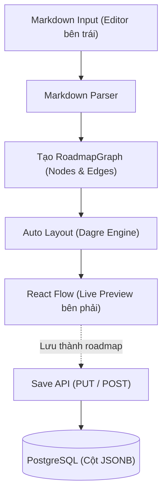

# Các contract cần nhóm thống nhất

Trạng thái: **ĐÃ BỔ SUNG ĐẦY ĐỦ NỘI DUNG CONTRACT PHASE 1 ĐỂ NHÓM REVIEW**.
Scaffold chưa triển khai schema hoặc API nghiệp vụ.
Nội dung dưới đây kết hợp thiết kế kick-off và các quy tắc bổ sung cho Phase 1, cần được nhóm review qua Pull Request trước khi triển khai.
Các checkbox thể hiện mức độ đã có thông tin trong tài liệu, không phải trạng thái hoàn thành code.

## Schema database

- [x] Bảng user và ràng buộc email.
- [x] Bảng roadmap, quyền sở hữu và cách lưu graph.
- [x] Token chia sẻ, cách bật/tắt và thu hồi link.
- [x] Quy tắc timestamp và xóa dữ liệu.

Quyết định: dùng PostgreSQL 18, hai bảng `users` và `roadmaps`, khóa chính INTEGER và lưu `nodes`/`edges` bằng JSONB.
Tắt chia sẻ bằng `is_public = false`; khi bật lại giữ mã cũ nếu đã có, chưa có cơ chế đổi mã để thu hồi vĩnh viễn link cũ.
Timestamp mặc định là `NOW()`; thao tác cập nhật roadmap phải làm mới `updated_at`.
Khóa chính dùng `INTEGER GENERATED ALWAYS AS IDENTITY`; `roadmaps.user_id` tham chiếu `users.id` với `ON DELETE CASCADE`.
Tạo index trên `roadmaps.user_id` để phục vụ truy vấn danh sách và kiểm tra chủ sở hữu.

### Bảng `users`

| Tên trường      | Kiểu dữ liệu   | Ràng buộc / Khóa / Chỉ mục                      |
| :-------------- | :------------- | :---------------------------------------------- |
| `id`            | `INTEGER`      | **Primary Key**, `GENERATED ALWAYS AS IDENTITY` |
| `email`         | `VARCHAR(255)` | `NOT NULL`, **Unique**                          |
| `password_hash` | `VARCHAR(255)` | `NOT NULL`                                      |
| `created_at`    | `TIMESTAMPTZ`  | `NOT NULL`, Default: `NOW()`                    |
| `updated_at`    | `TIMESTAMPTZ`  | `NOT NULL`, Default: `NOW()`                    |

---

### Bảng `roadmaps`

| Tên trường      | Kiểu dữ liệu   | Ràng buộc / Khóa / Chỉ mục                                     |
| :-------------- | :------------- | :------------------------------------------------------------- |
| `id`            | `INTEGER`      | **Primary Key**, `GENERATED ALWAYS AS IDENTITY`                |
| `user_id`       | `INTEGER`      | `NOT NULL`, tham chiếu `users(id)`, `ON DELETE CASCADE`, index |
| `title`         | `VARCHAR(255)` | `NOT NULL`                                                     |
| `graph_version` | `INTEGER`      | `NOT NULL`, Default: `1`, `CHECK (graph_version = 1)`          |
| `nodes`         | `JSONB`        | `NOT NULL`, Default: `'[]'::jsonb`                             |
| `edges`         | `JSONB`        | `NOT NULL`, Default: `'[]'::jsonb`                             |
| `is_public`     | `BOOLEAN`      | `NOT NULL`, Default: `FALSE`                                   |
| `share_code`    | `VARCHAR(16)`  | **Unique**                                                     |
| `created_at`    | `TIMESTAMPTZ`  | `NOT NULL`, Default: `NOW()`                                   |
| `updated_at`    | `TIMESTAMPTZ`  | `NOT NULL`, Default: `NOW()`                                   |

### Timestamp và xóa dữ liệu

- Mọi timestamp dùng `TIMESTAMPTZ`, do backend/database tạo, trả về chuỗi ISO 8601 UTC như `2026-11-04T07:10:00.000Z`.
- Khi tạo bản ghi, `created_at` và `updated_at` cùng dùng `NOW()` trong một câu lệnh INSERT.
- `created_at` không thay đổi; mọi UPDATE user hoặc roadmap phải đặt `updated_at = NOW()` trong cùng câu lệnh SQL, kể cả khi bật/tắt chia sẻ.
- Phase 1 cập nhật timestamp tường minh trong SQL, không dùng trigger; giá trị default chỉ có tác dụng khi INSERT.
- Frontend không được gửi `createdAt`, `updatedAt`, `userId`, `id`, `shareCode` hoặc `passwordHash` để tự gán các trường do server quản lý.
- Xóa roadmap là hard delete; node, edge và mã chia sẻ biến mất cùng bản ghi, link cũ trả `404 NOT_FOUND`.
- Gửi DELETE lần nữa với roadmap đã xóa trả `404 NOT_FOUND`; API không phục hồi dữ liệu đã xóa.
- Nếu xóa user bằng tác vụ quản trị sau này, foreign key xóa toàn bộ roadmap của user bằng cascade; Phase 1 chưa cung cấp API xóa tài khoản.
- Không sửa migration đã áp dụng và merge; thêm migration mới khi thay đổi schema.

## API contract

- [x] Endpoint, request và response cho auth.
- [x] Endpoint, request và response cho CRUD roadmap.
- [x] Endpoint private/public cho chia sẻ.
- [x] Validation, status code và quyền truy cập.

Scaffold đã dùng tiền tố `/api` và success envelope `{ data: ... }`.
Error envelope hiện tại là `{ error: { code, message } }`.
Các health endpoint được mô tả trong README.
Mọi response thành công bên dưới được bọc trong `data` để thống nhất với scaffold, không thêm trường `success`.
Quy tắc validation, status code và quyền truy cập được mô tả bên dưới.

### Quy ước chung

- **Base URL:** `/api`
- **Content-Type:** `application/json`
- **Authentication:** Các endpoint có đánh dấu 🔒 yêu cầu header:
  ```http
  Authorization: Bearer <jwt_token>
  ```
- **Quy ước đặt tên trường JSON:** Dùng `camelCase` cho mọi request/response body của API (Backend tự map từ `snake_case` của DB sang `camelCase` trước khi trả về).

### Api response và format lỗi

Mọi lỗi trả về từ Backend (400, 401, 403, 404, 409, 413, 500, 503) **bắt buộc** tuân theo cấu trúc sau để Frontend và TanStack Query xử lý thống nhất:

```json
{
  "error": {
    "code": "INVALID_CREDENTIALS",
    "message": "Email hoặc mật khẩu không chính xác"
  }
}
```

**Danh sách mã lỗi (`error.code`) thông dụng:**

| HTTP status | `error.code`                | Khi nào trả về                                                                                   |
| :---------- | :-------------------------- | :----------------------------------------------------------------------------------------------- |
| 400         | `VALIDATION_ERROR`          | JSON hợp lệ nhưng trường dữ liệu, ID, phiên bản graph hoặc cấu trúc graph không hợp lệ           |
| 400         | `INVALID_JSON`              | Request body không phải JSON hợp lệ                                                              |
| 401         | `INVALID_CREDENTIALS`       | Email hoặc mật khẩu đăng nhập không đúng, dùng chung message để không phân biệt email có tồn tại |
| 401         | `UNAUTHORIZED`              | Thiếu Bearer token, token sai chữ ký, hết hạn hoặc user trong token không còn tồn tại            |
| 403         | `FORBIDDEN`                 | Roadmap tồn tại nhưng không thuộc user hiện tại trên endpoint riêng tư                           |
| 404         | `NOT_FOUND`                 | Endpoint/roadmap không tồn tại hoặc link chia sẻ không tồn tại/đã tắt                            |
| 409         | `EMAIL_ALREADY_EXISTS`      | Email sau chuẩn hóa đã được đăng ký                                                              |
| 413         | `PAYLOAD_TOO_LARGE`         | JSON request vượt 1 MiB (1.048.576 byte), theo JSON parser hiện có                               |
| 500         | `INTERNAL_ERROR`            | Lỗi ngoài dự kiến, message chung, không trả stack trace hay dữ liệu kết nối                      |
| 503         | `DATABASE_NOT_CONFIGURED`   | Readiness chưa được cấu hình database                                                            |
| 503         | `DATABASE_UNAVAILABLE`      | Readiness không kết nối được database                                                            |
| 503         | `DATABASE_VERSION_MISMATCH` | Readiness phát hiện PostgreSQL khác major 18                                                     |

### Validation request

Backend là nơi kiểm tra bắt buộc; frontend kiểm tra cùng quy tắc để hiển thị lỗi sớm.
Các trường không nằm trong request contract bị từ chối với `400 VALIDATION_ERROR`.
Giới hạn ký tự tính theo Unicode code point; giới hạn byte tính theo UTF-8.

| Trường hoặc request  | Quy tắc Phase 1                                                                                                                                      |
| :------------------- | :--------------------------------------------------------------------------------------------------------------------------------------------------- |
| `email`              | String đúng định dạng email, trim hai đầu, chuyển lowercase, tối đa 255 ký tự; lưu dạng đã chuẩn hóa và dùng UNIQUE trong DB                         |
| `password` đăng ký   | String ít nhất 8 ký tự và không quá 72 byte UTF-8; không trim hay đổi chữ hoa/thường                                                                 |
| `password` đăng nhập | String không rỗng và không quá 72 byte UTF-8; không áp lại yêu cầu độ dài đăng ký cho việc kiểm tra thông tin đăng nhập                              |
| `title`              | String sau trim dài 1-255 ký tự, một dòng                                                                                                            |
| `:id`                | Chuỗi chữ số biểu diễn số nguyên dương, không dấu và không phần thập phân, tối đa 2.147.483.647                                                      |
| `shareCode`          | Đúng 6 ký tự lowercase hoặc chữ số, mẫu `^[a-z0-9]{6}$`; mã không khớp trả `404 NOT_FOUND`                                                           |
| `isPublic`           | Boolean thật, không chấp nhận string `"true"`, `"false"` hoặc number                                                                                 |
| Tạo roadmap          | Bắt buộc `title`; `nodes`, `edges` mặc định `[]`; `graphVersion` mặc định `1`                                                                        |
| Cập nhật roadmap     | Giữ PUT hỗ trợ từng phần theo kick-off; phải có ít nhất một trong `title`, `nodes`, `edges`; được gửi thêm `graphVersion: 1`; không chấp nhận `null` |
| Graph khi cập nhật   | Trường bị bỏ qua giữ nguyên; mảng được gửi thay thế toàn bộ mảng cũ; kiểm tra graph sau khi ghép với dữ liệu hiện có trước khi ghi DB                |
| Graph và request lớn | Tuân thủ giới hạn ở mục graph bên dưới và giới hạn JSON 1 MiB, áp dụng cả khi cập nhật từng phần                                                     |

Nếu cập nhật graph gồm cả xóa node và xóa cạnh liên quan, frontend gửi đồng thời `nodes` và `edges` trong một request.
Một request thay đổi graph không hợp lệ bị từ chối toàn bộ, không lưu một phần.
Ghi `nodes`, `edges`, `graph_version` và `updated_at` trong cùng một UPDATE; nếu cần đọc trước để ghép bản cập nhật, dùng transaction và row lock để tránh ghi đè do hai request chạy đồng thời.

### Xác thực và quyền truy cập

- Các endpoint auth register/login, health và xem link chia sẻ là public; endpoint còn lại yêu cầu JWT hợp lệ.
- JWT chứa `sub` là user ID, `iat` và `exp`; dùng secret từ môi trường, kiểm tra chữ ký, thời hạn và chỉ chấp nhận thuật toán HS256.
- Thời hạn token lấy từ `JWT_EXPIRES_IN`, mặc định `1d`; Phase 1 không có refresh token hoặc danh sách thu hồi JWT.
- Frontend lưu token trong localStorage theo brief; logout xóa token và dữ liệu cache riêng tư.
- Với `401 UNAUTHORIZED` từ endpoint riêng tư, frontend xóa token, xóa cache riêng tư rồi chuyển về `/login`; `401 INVALID_CREDENTIALS` ở trang login chỉ hiển thị lỗi đăng nhập.
- `GET /api/roadmaps` luôn lọc `WHERE user_id = $1`, không nhận `userId` từ client để chọn chủ sở hữu.
- Các truy vấn GET/UPDATE/DELETE roadmap riêng tư và bật/tắt chia sẻ luôn ràng buộc cả `id` và `user_id` trong SQL.
- Với token hợp lệ, nếu truy vấn có ràng buộc chủ sở hữu không tìm thấy bản ghi, chỉ kiểm tra sự tồn tại để phân biệt `403 FORBIDDEN` với `404 NOT_FOUND`; không trả nội dung của người khác.
- Roadmap có `is_public = true` vẫn không cho người khác sửa; xem công khai chỉ đi qua `GET /api/share/:shareCode`.
- API share chỉ SELECT khi đồng thời đúng `share_code` và `is_public = true`, không cung cấp endpoint ghi công khai.
- `password_hash` không được trả về ở bất kỳ response nào; user ID tạo roadmap lấy từ JWT đã xác thực.
- Mã chia sẻ sinh bằng bộ sinh số ngẫu nhiên an toàn, giữ UNIQUE trong DB; khi trùng mã thử lại tối đa 5 lần, vẫn thất bại trả `500 INTERNAL_ERROR` và không lưu trạng thái bật chia sẻ dở dang.
- Phân biệt thứ tự kiểm tra: JSON parser và giới hạn payload, xác thực endpoint riêng tư, validation dữ liệu nghiệp vụ, quyền sở hữu, thực hiện thao tác.

---

### Nhóm API Xác thực (Auth)

#### Đăng ký tài khoản

- **Endpoint:** `POST /api/auth/register`
- **Auth:** Public
- **Request Body:**
  ```json
  {
    "email": "quang@cmc.com.vn",
    "password": "password123"
  }
  ```
- **Response `201 Created`:**
  ```json
  {
    "data": {
      "token": "eyJhbGciOiJIUzI1NiIsInR5cCI6IkpXVCJ9...",
      "user": {
        "id": 1,
        "email": "quang@cmc.com.vn",
        "createdAt": "2026-11-04T07:00:00.000Z"
      }
    }
  }
  ```

#### Đăng nhập

- **Endpoint:** `POST /api/auth/login`
- **Auth:** Public
- **Request Body:**
  ```json
  {
    "email": "quang@cmc.com.vn",
    "password": "password123"
  }
  ```
- **Response `200 OK`:** Giống hệt cấu trúc `201 Created` của Đăng ký.

#### Lấy thông tin user hiện tại (kiểm tra phiên đăng nhập)

- **Endpoint:** `GET /api/auth/me`
- **Auth:** 🔒 Cần Token
- **Response `200 OK`:**
  ```json
  {
    "data": {
      "user": {
        "id": 1,
        "email": "quang@cmc.com.vn",
        "createdAt": "2026-11-04T07:00:00.000Z"
      }
    }
  }
  ```

---

### Nhóm API Quản lý Roadmap (Dùng cho cả Canvas & Playground)

#### Lấy danh sách roadmap của tôi

- **Endpoint:** `GET /api/roadmaps`
- **Auth:** 🔒 Cần Token
- **Response `200 OK`:** (Trả về danh sách tóm tắt để trang "Roadmap của tôi" tải nhanh)
  ```json
  {
    "data": {
      "roadmaps": [
        {
          "id": 10,
          "title": "Lộ trình học Frontend React",
          "nodeCount": 8,
          "isPublic": true,
          "shareCode": "k8f2xq",
          "createdAt": "2026-11-04T07:10:00.000Z",
          "updatedAt": "2026-11-04T08:30:00.000Z"
        }
      ]
    }
  }
  ```

#### Tạo mới roadmap (Từ trang danh sách hoặc bấm "Lưu" từ Playground)

- **Endpoint:** `POST /api/roadmaps`
- **Auth:** 🔒 Cần Token
- **Request Body:** (`nodes` và `edges` là tùy chọn; nếu không gửi thì mặc định là `[]`)
  ```json
  {
    "title": "Lộ trình học Frontend React",
    "nodes": [
      {
        "id": "node-1",
        "type": "default",
        "position": {
          "x": 100,
          "y": 50
        },
        "data": {
          "label": "Nền tảng Web",
          "description": "HTML, CSS, JavaScript ES6+"
        }
      }
    ],
    "edges": [],
    "graphVersion": 1
  }
  ```
- **Response `201 Created`:**
  ```json
  {
    "data": {
      "roadmap": {
        "id": 10,
        "userId": 1,
        "title": "Lộ trình học Frontend React",
        "nodes": [
          {
            "id": "node-1",
            "type": "default",
            "position": {
              "x": 100,
              "y": 50
            },
            "data": {
              "label": "Nền tảng Web",
              "description": "HTML, CSS, JavaScript ES6+"
            }
          }
        ],
        "edges": [],
        "isPublic": false,
        "shareCode": null,
        "createdAt": "2026-11-04T07:10:00.000Z",
        "updatedAt": "2026-11-04T07:10:00.000Z",
        "graphVersion": 1
      }
    }
  }
  ```

#### Xem chi tiết 1 roadmap (Mở trên Canvas để sửa)

- **Endpoint:** `GET /api/roadmaps/:id`
- **Auth:** 🔒 Cần Token (Chỉ chủ sở hữu mới xem được qua endpoint này)
- **Response `200 OK`:** Trả về `{ "data": { "roadmap": { ... } } }` đầy đủ `graphVersion`, `nodes` và `edges` giống response tạo mới.

#### Cập nhật roadmap (Đổi tên hoặc Lưu vị trí/nội dung nodes & edges trên Canvas)

- **Endpoint:** `PUT /api/roadmaps/:id`
- **Auth:** 🔒 Cần Token
- **Request Body:** (Cho phép gửi từng phần hoặc cả 3 trường `title`, `nodes`, `edges`)
  ```text
  {
    "title": "Lộ trình Frontend 2026",
    "nodes": [...],
    "edges": [...]
  }
  ```
- **Response `200 OK`:** Trả về `{ "data": { "roadmap": { ... } } }` sau khi đã cập nhật và làm mới `updatedAt`.

#### Xóa roadmap

- **Endpoint:** `DELETE /api/roadmaps/:id`
- **Auth:** 🔒 Cần Token
- **Response `200 OK`:**
  ```json
  {
    "data": {
      "message": "Đã xóa roadmap thành công"
    }
  }
  ```

---

### Nhóm API Chia sẻ Roadmap (Share Link)

#### Bật / Tắt chế độ chia sẻ

- **Endpoint:** `PATCH /api/roadmaps/:id/share`
- **Auth:** 🔒 Cần Token
- **Logic Backend:**
  - Nếu `isPublic: true` và roadmap chưa có `share_code`, sinh mã ngẫu nhiên 6 ký tự chữ thường + số (VD: `k8f2xq`) và lưu vào DB. Nếu đã có `share_code` từ trước thì giữ nguyên mã đó để không làm hỏng link cũ.
  - Nếu `isPublic: false`, cập nhật `is_public = false` (mọi truy cập vào link chia sẻ sẽ nhận lỗi `404 NOT_FOUND`).
- **Request Body:**
  ```json
  {
    "isPublic": true
  }
  ```
- **Response `200 OK`:**
  ```json
  {
    "data": {
      "id": 10,
      "isPublic": true,
      "shareCode": "k8f2xq"
    }
  }
  ```

#### Xem roadmap qua link chia sẻ (Chế độ chỉ đọc)

- **Endpoint:** `GET /api/share/:shareCode`
- **Auth:** Public (Không cần đăng nhập)
- **Response `200 OK`:** (Chỉ trả về khi tìm thấy `share_code` VÀ `is_public = true`)
  ```text
  {
    "data": {
      "roadmap": {
        "graphVersion": 1,
        "title": "Lộ trình học Frontend React",
        "nodes": [...],
        "edges": [...],
        "authorEmail": "quang@cmc.com.vn",
        "updatedAt": "2026-11-04T08:30:00.000Z"
      }
    }
  }
  ```
- **Response `404 Not Found`:** Khi `shareCode` không tồn tại hoặc chủ sở hữu đã tắt chia sẻ (`is_public = false`).

## Định dạng graph dùng chung

- [x] Kiểu node, label, description, position và ID.
- [x] Kiểu edge và quy tắc kết nối.
- [x] Phiên bản dữ liệu và viewport nếu cần.
- [x] Validation và giới hạn kích thước.

Quyết định: Canvas, Playground và backend dùng chung cấu trúc `nodes`/`edges` dưới đây.
Node dùng `type: "default"`; edge mặc định là `smoothstep` và `animated: false`.
Các ví dụ API dùng cùng `type: "default"`, không có trường `data.level` ngoài contract.

### Phiên bản dữ liệu và viewport

- `RoadmapGraph` gồm `graphVersion: 1`, `nodes` và `edges`.
- DB lưu phiên bản bằng `roadmaps.graph_version`, mặc định `1`; response chi tiết và response share luôn có `graphVersion`.
- Request tạo/cập nhật có thể bỏ `graphVersion` để dùng `1`; nếu gửi thì phải là số nguyên `1`, phiên bản khác trả `400 VALIDATION_ERROR`.
- Thay đổi phá vỡ tương thích sau Phase 1 phải tăng phiên bản và bổ sung migration/chuyển đổi dữ liệu, không âm thầm diễn giải graph cũ theo định dạng mới.
- Phase 1 không lưu viewport gồm pan/zoom trong DB, không nhận trường `viewport` ở API.
- Khi mở roadmap đã lưu, giữ nguyên `position` của node và dùng `fitView` để chọn vùng nhìn; không tự chạy lại Dagre.
- Import Markdown tạo bố cục mới bằng Dagre vì Markdown không lưu tọa độ hoặc viewport.

### Validation và giới hạn graph

| Thành phần                 | Quy tắc                                                                                                                                          |
| :------------------------- | :----------------------------------------------------------------------------------------------------------------------------------------------- |
| `nodes`, `edges`           | Phải là mảng, không nhận `null`; cho phép graph rỗng và node không có cạnh                                                                       |
| Số lượng                   | Tối đa 500 node và 1.000 edge trên một roadmap, frontend áp dụng cùng giới hạn                                                                   |
| Node ID                    | String 1-64 ký tự, mẫu `^[a-zA-Z0-9_-]+$`, duy nhất trong roadmap                                                                                |
| Node type                  | Bắt buộc `"default"`, không nhận custom type khác                                                                                                |
| `data.label`               | String trim dài 1-255 ký tự, không chứa CR/LF                                                                                                    |
| `data.description`         | Tùy chọn, string một dòng tối đa 2.000 ký tự, có thể rỗng; không nhận `null`                                                                     |
| `position.x`, `position.y` | Number hữu hạn từ -1.000.000 đến 1.000.000, cho phép số âm và số thập phân, không nhận numeric string                                            |
| Edge ID                    | String 1-200 ký tự, duy nhất trong roadmap                                                                                                       |
| `source`, `target`         | Phải trỏ tới hai node tồn tại và khác nhau; không chấp nhận self-loop hoặc hai cạnh cùng cặp source/target                                       |
| Cạnh nối chéo và chu trình | Cho phép cạnh nối chéo, cạnh ngược chiều và chu trình qua nhiều node; không coi thứ tự khai báo là thứ tự thực thi                               |
| `type` của edge            | Chỉ `"smoothstep"` hoặc `"default"`; thiếu thì chuẩn hóa thành `"smoothstep"`                                                                    |
| `animated`                 | Chỉ boolean; thiếu thì chuẩn hóa thành `false`                                                                                                   |
| Trường ngoài contract      | Backend từ chối; frontend chỉ serialize trường được định nghĩa, không lưu `selected`, `dragging`, `measured`, callback hoặc trạng thái UI vào DB |
| Kích thước request         | Tổng JSON request không quá 1 MiB; graph dưới giới hạn node/edge vẫn có thể bị từ chối vì vượt giới hạn byte                                     |

Backend kiểm tra cả tính hợp lệ từng phần tử và tham chiếu giữa các phần tử trước khi lưu.
Sai cấu trúc, trùng ID, cạnh không hợp lệ hoặc vượt giới hạn node/edge trả `400 VALIDATION_ERROR`; vượt kích thước JSON trả `413 PAYLOAD_TOO_LARGE`.
Xóa node trên Canvas đồng thời loại các edge tham chiếu tới node đó trước khi gửi request.
ID edge tự sinh bắt đầu bằng `edge-{source}-{target}`; nếu đã được dùng bởi cặp khác thì nối hậu tố `-2`, `-3`, ... cho tới khi duy nhất.
Backend không suy ra source/target từ ID edge, chỉ dùng các trường `source` và `target`.

```typescript
// Dữ liệu bên trong mỗi Node của React Flow
export interface RoadmapNodeData extends Record<string, unknown> {
  label: string; // Tên node
  description?: string; // Mô tả chi tiết
}

// Cấu trúc 1 Node
export interface RoadmapNode {
  id: string; // ID duy nhất trong phạm vi 1 roadmap (VD: "node-1", "n_abc123")
  type: 'default'; // dùng chung trên toàn app
  position: {
    x: number; // Tọa độ ngang trên Canvas
    y: number; // Tọa độ dọc trên Canvas
  };
  data: RoadmapNodeData;
}

// Cấu trúc 1 Edge
export interface RoadmapEdge {
  id: string; // "edge-{source}-{target}", thêm hậu tố số nếu trùng ID
  source: string; // ID của node bắt đầu
  target: string; // ID của node kết thúc
  type?: 'smoothstep' | 'default';
  animated?: boolean; // Mặc định false
}

export interface RoadmapGraph {
  graphVersion: 1;
  nodes: RoadmapNode[];
  edges: RoadmapEdge[];
}
```

## Markdown Playground

- [x] Heading, bullet, indent và mô tả.
- [x] Quy tắc sinh node/edge và ID.
- [x] Auto layout và xử lý cú pháp lỗi.
- [x] Khả năng export/import lại graph, đặc biệt với cạnh nối chéo.

Quyết định: dùng heading để khai báo title và node, dòng kế tiếp cho mô tả và khai báo cạnh bằng ID tường minh.
Bản cú pháp này không quy định bullet hoặc indent để tạo quan hệ giữa các node.
Parser viết bằng TypeScript, auto layout dùng Dagre, hiển thị bằng `@xyflow/react` và debounce 200ms.
Cạnh nối chéo được biểu diễn bằng `source` và `target`; xuất Markdown không giữ tọa độ và import sẽ tính lại bố cục.
Auto layout và lỗi cú pháp được xử lý theo quy tắc chi tiết bên dưới.
Khi tạo mới roadmap từ Playground, API yêu cầu `title` ngoài `nodes` và `edges`.

### Quy tắc cú pháp tổng quát

| Cấu phần            | Cú pháp                                           |  Bắt buộc   | Giá trị hợp lệ / Mặc định                                          | Ý nghĩa & Ánh xạ vào `@xyflow/react`                                                                                                                             |
| :------------------ | :------------------------------------------------ | :---------: | :----------------------------------------------------------------- | :--------------------------------------------------------------------------------------------------------------------------------------------------------------- |
| **Tiêu đề Roadmap** | `# <title>`                                       |    Không    | Text tự do                                                         | Đặt tên cho roadmap. **Không tạo Node**                                                                                                                          |
| **Khai báo Node**   | `## [<id>] <label>`                               | Khi có node | `<id>`: `[a-zA-Z0-9_-]+`; `<label>`: Text tự do                    | `<id>` → `node.id`; `<label>` → `node.data.label`                                                                                                                |
| **Mô tả Node**      | Dòng văn bản ngay sau `## [id] ...`               |    Không    | Text tự do (một dòng)                                              | → `node.data.description`                                                                                                                                        |
| **Khai báo Edge**   | `<source> → <target>` hoặc `<source> -> <target>` |    Không    | Cả 2 ID phải đã khai báo. `[animated]` và `[type=...]` là tùy chọn | `source` → `edge.source`; `target` → `edge.target`; `[animated]` → `edge.animated = true`; `[type=default]` → `edge.type = "default"` (mặc định: `"smoothstep"`) |

---

### Bảng ánh xạ ví dụ thực tế

| Tình huống sử dụng | Cú pháp Markdown Playground                            | Thuộc tính `@xyflow/react` tương ứng                                       |
| :----------------- | :----------------------------------------------------- | :------------------------------------------------------------------------- |
| Tiêu đề roadmap    | `# Onboarding Frontend`                                | Roadmap title = `"Onboarding Frontend"`                                    |
| Node đơn giản      | `## [setup] Chuẩn bị môi trường`                       | `id: "setup"`, `data: { label: "Chuẩn bị môi trường" }`                    |
| Node có mô tả      | `## [ts] TypeScript` → dòng tiếp `Kiểu dữ liệu và hàm` | `data: { label: "TypeScript", description: "Kiểu dữ liệu và hàm" }`        |
| Nối cơ bản         | `setup → ts`                                           | `source: "setup"`, `target: "ts"`, `type: "smoothstep"`, `animated: false` |
| Nối có hiệu ứng    | `ts → react [animated]`                                | `animated: true`, `type: "smoothstep"`                                     |
| Nối cong bezier    | `a → b [type=default]`                                 | `type: "default"`, `animated: false`                                       |

---

### Ví dụ file Markdown mẫu

```markdown
# Onboarding Frontend

## [setup] Chuẩn bị môi trường

Cài Git và Node.js

## [ts] Nền tảng TypeScript

Kiểu dữ liệu và hàm

## [react] React cơ bản

Component, props và state

setup → ts
ts → react
```

---

### Quy trình xử lý



**Giải thích:**

1. Người dùng nhập Markdown theo cú pháp `# Title`, `## [id] Label`, dòng mô tả, và `id1 → id2`.
2. Parser phân tích từng dòng: nhận diện node qua `## [id]`, mô tả qua dòng liền kế, edge qua `→` hoặc `->`.
3. Tạo mảng `RoadmapNode[]` và `RoadmapEdge[]` đúng chuẩn `@xyflow/react`.
4. Dagre tính toán tọa độ node theo quy tắc auto layout bên dưới; không thay đổi ID, nội dung hoặc hướng cạnh.
5. React Flow nhận dữ liệu và cập nhật sơ đồ trực quan theo thời gian thực (debounce 200ms).
6. Khi người dùng bấm "Lưu thành roadmap", Frontend gửi `{ title, graphVersion: 1, nodes, edges }` lên API tạo mới, hoặc các trường thay đổi hợp lệ lên API cập nhật.

---

### Auto layout và xử lý cú pháp lỗi

- Sau 200ms kể từ lần gõ cuối, parser chạy trên toàn bộ tài liệu và chỉ cập nhật preview nếu kết quả hợp lệ.
- Parser xử lý hai lượt: thu thập node trước, kiểm tra và tạo edge sau; một edge có thể tham chiếu node khai báo ở dòng phía dưới.
- Chỉ chấp nhận tối đa một heading `# <title>`; nếu không có title thì dùng `Roadmap chưa đặt tên`, title có nhưng rỗng là lỗi.
- Dòng trống được bỏ qua; tài liệu trống tạo graph rỗng hợp lệ, không có node hoặc edge nào.
- Description chỉ là một dòng ngay sau khai báo node; một dòng khác không thuộc cú pháp đã định nghĩa là lỗi, không tự chuyển bullet/indent thành node.
- Nếu description có hình thức giống khai báo title, node, edge hoặc bắt đầu bằng dấu `\`, exporter thêm một dấu `\` ở đầu; parser bỏ đúng một dấu escape này khi đọc description ngay sau node.
- ID trùng, label rỗng, ID không hợp lệ, edge thiếu node, self-loop, cặp cạnh trùng, tùy chọn không hỗ trợ và dữ liệu vượt giới hạn graph đều là lỗi.
- Edge chấp nhận `[animated]`, `[type=default]` hoặc `[type=smoothstep]`, mỗi tùy chọn tối đa một lần, theo thứ tự bất kỳ ở cuối dòng.
- Báo lỗi bằng danh sách `{ line, column, code, message }`, trong đó line/column bắt đầu từ 1 và message dùng để hiển thị cạnh editor; lỗi parser là lỗi local, không gọi API.
- Các code parser gồm `INVALID_SYNTAX`, `DUPLICATE_NODE_ID`, `UNKNOWN_NODE`, `INVALID_EDGE`, `GRAPH_LIMIT_EXCEEDED` và `LAYOUT_FAILED`.
- Khi bản nháp có lỗi, giữ preview hợp lệ gần nhất và hiển thị rõ preview chưa khớp bản nháp; nếu chưa có kết quả hợp lệ thì preview rỗng.
- Khóa nút lưu và xuất file từ Playground khi bản nháp có lỗi, đang chờ debounce hoặc đang tính layout; không tự lưu hoặc gửi graph hợp lệ cũ thay cho bản nháp lỗi.
- Bỏ kết quả parse/layout cũ nếu người dùng đã sửa nội dung sau khi tác vụ bắt đầu, để preview luôn tương ứng phiên bản mới nhất.
- Dagre dùng hướng trái sang phải (`rankdir: LR`), khoảng cách cùng tầng `nodesep: 40`, giữa các tầng `ranksep: 80`, lề `marginx/marginy: 24` pixel.
- Dùng kích thước node đã đo; nếu chưa đo thì dùng fallback rộng 240 và cao 100 pixel, đo lại sau render khi kích thước thay đổi.
- Chuyển tọa độ tâm Dagre sang góc trên trái React Flow bằng cách trừ nửa chiều rộng/chiều cao node; chỉ gọi `fitView` sau khi áp dụng layout hợp lệ.
- Chu trình không bị xóa hoặc đảo source/target trong graph; việc Dagre xử lý chu trình nội bộ chỉ phục vụ tính bố cục.
- Nếu layout lỗi, trả lỗi local `LAYOUT_FAILED`, giữ preview hợp lệ gần nhất và không tự thay graph bằng mảng rỗng.
- Chỉ auto layout ở Playground khi parse hợp lệ hoặc khi người dùng chủ động yêu cầu; không ghi đè tọa độ khi tải roadmap từ API.

### Quy tắc xuất Markdown

- Xuất title thành `# title`, sau đó xuất toàn bộ node trước và edge sau để parser đọc lại được.
- Mỗi Node xuất thành `## [id] label` + dòng description ngay bên dưới (nếu có).
- Mỗi Edge xuất thành `source → target` kèm `[animated]` và/hoặc `[type=...]` nếu khác mặc định.
- Giữ nguyên node ID, label, description, source/target, edge type và animated sau vòng xuất/nhập; ID edge có thể được sinh lại theo quy tắc chống trùng.
- Không lưu tọa độ `x`, `y` vào nội dung Markdown - Auto Layout (Dagre) sẽ tính lại khi import.

## Ghi nhận thống nhất

- Nguồn: tài liệu "Betterflow - Thống nhất thiết kế kỹ thuật (Kick-off)" do nhóm cung cấp.
- Ngày kick-off: chưa được ghi trong tài liệu nguồn.
- Người tham gia: chưa được ghi trong tài liệu nguồn.
- Quyết định: schema, API, graph và cú pháp Markdown được ghi tại các mục tương ứng ở trên.
- Các quy tắc bổ sung trong lần hoàn thiện này gồm timestamp/xóa dữ liệu, validation/quyền truy cập, graphVersion/viewport, giới hạn graph và auto layout/lỗi parser.
- Toàn bộ checkbox đã có nội dung contract; nhóm vẫn review các quyết định bổ sung trong PR, không coi đây là xác nhận code đã hoàn thành.

Các email, mật khẩu, token và timestamp trong ví dụ là dữ liệu minh họa.
Các code block dùng `[...]` chỉ minh họa cấu trúc, không phải JSON có thể gửi trực tiếp.
